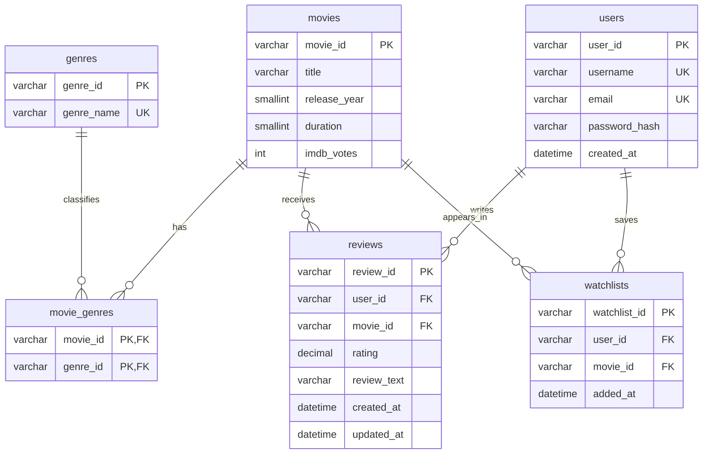

# Relational design (Xue E)

The cleaned datasets still map to the existing six InnoDB tables. There are no changes to their names, columns, IDs, import layouts or source CSVs. `02_create_tables.sql` is the schema source of truth; `00_workbench_server_import.sql` contains the same schema for the alternate import route.

`reviews(user_id, movie_id)` and `watchlists(user_id, movie_id)` are additional composite candidate keys. Review ratings are 1.0–10.0 with one decimal, not a five-star storage scale. UI stars are only a presentation choice.

## Dependencies and normalization

| Relation | Functional dependency / reason |
|---|---|
| `movies` | `movie_id →` movie attributes; no genre-name list, user ratings or review counts are stored here |
| `genres` | `genre_id → genre_name`; the unique genre name is another candidate key |
| `movie_genres` | Composite `(movie_id, genre_id)` identifies membership; no partial-dependent attributes |
| `users` | `user_id → username, email, password_hash, created_at`; username/email are unique candidate keys |
| `reviews` | `review_id →` review attributes and `(user_id, movie_id) →` the same review; username/title stay in their parent tables |
| `watchlists` | `watchlist_id →` entry attributes and `(user_id, movie_id) →` the same saved entry |

Genre extraction removes the source's repeating genre list and implements the many-to-many relation. Movie/user descriptions are not repeated in review or watchlist rows; joins retrieve them. Non-key attributes depend on a candidate key, with no partial/transitive dependencies between the modeled entities (3NF). Director and comma-separated `cast` are retained as source display text because the supplied data has no person entities/IDs and the shared app does not query individual actors; a person/credit model would be a separate extension if actor-level operations become required. Average rating, counts and engagement are derived, never independently stored.

## Integrity

PKs reject duplicate IDs. UNIQUE constraints reject duplicate usernames/emails and multiple reviews/saves for a user/movie. Foreign keys reject orphan movie/user/genre references. Deleting a user/movie cascades its dependent reviews/watchlists; deleting a used genre is restricted. CHECK constraints enforce release years 1888–2100, positive runtimes, 1–10 ratings and `updated_at >= created_at`. NOT NULL and field lengths preserve the cleaned structure. The existing database collation gives case-insensitive account uniqueness; the callable layer trims names and lowercases emails.

Password hashing and validation of typed input belong in the callable database boundary as well as database constraints. The Python layer binds values, validates finite numeric ratings/text lengths and keeps hashes out of public user results. Ownership checks use a supplied actor's `user_id` in the UPDATE/DELETE predicate; determining that actor belongs to Minal's authenticated session.

## SQL features and access paths

`05_crud_queries.sql` demonstrates rolled-back CRUD, a JSON_TABLE genre selection, relational division (`NOT EXISTS` / `NOT EXISTS`), literal substring search, ranges and sort selection. `06_advanced_queries.sql` retains eight analyses with joins, aggregate CTEs, HAVING, ROW_NUMBER partitions, UNION and correlated exclusion subqueries. Its callable counterparts live in `analytics.py`.

`07_views.sql` creates live movie review statistics, a complete movie catalogue and a user activity summary. Each independent child relationship is aggregated before joining, preventing inflated counts and review/watchlist products. Existing `average_rating` columns remain available; `avg_rating` is also exposed for the UI.

| Index | Justification |
|---|---|
| Existing PK / UNIQUE / FK indexes | IDs, account lookup, membership joins, unique user/movie lookup; do not duplicate these |
| `movies(release_year, title)` | Year filtering/order; not a seek index for `%substring%` title search |
| `reviews(movie_id, rating)` | Cover per-movie rating AVG/COUNT |
| `reviews(created_at)` | Latest review feed |
| `reviews(movie_id, updated_at)` | One movie's newest-edited reviews |
| `reviews(user_id, updated_at)` | One user's newest-edited reviews |
| `watchlists(user_id, added_at)` | One user's newest saves |

Only the two review-order indexes are new. Review averages are computed, so an index on a hypothetical stored movie `avg_rating` is inappropriate. No FULLTEXT index, people tables, counters, stored summaries or MongoDB-style denormalization are introduced. Use the eight EXPLAIN examples and measured workload before adding more indexes.
